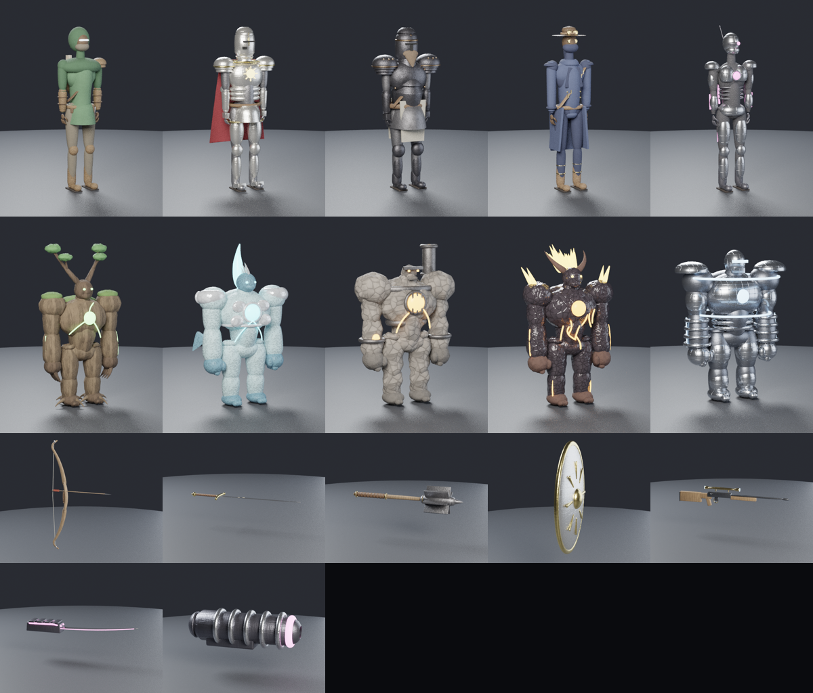

# 10 · Modelos 3D de Blender, texturas PBR y animación procedural

Este documento explica, paso a paso, cómo se crean los modelos y las texturas del juego, cómo llegan a Unity y cómo se animan. Todo se genera **con código** (Python para Blender y numpy), así que se puede regenerar, modificar y ampliar sin herramientas de pago.



> **Qué hay y qué no.** Hay 17 modelos FBX (5 humanos, 5 guardianes, 5 armas, escudo y cañón de pulso) y 19 texturas PBR repetibles, integrados en el juego y animados por código. Son **modelos procedurales de calidad de prototipo avanzado**, construidos con formas paramétricas, biselados, subdivisión y relieve procedural. **No sustituyen** a un artista 3D: no tienen esculpido de alta resolución, rostros, UV desplegadas a mano, ni rig con pesos para animación capturada. El Doc 06 sigue siendo la guía para la producción artística definitiva; este pipeline permite jugar ya con siluetas, materiales y proporciones correctas, y cualquier FBX de un artista que respete los nombres del esqueleto sustituye al generado sin tocar código.

---

## Nivel 1 — Qué se genera y dónde queda

| Carpeta | Contenido | Generado por |
|---|---|---|
| `Assets/Resources/Modelos/Humanos/` | `Cazador.fbx`, `Paladin.fbx`, `Bastion.fbx`, `Tirador.fbx`, `Ciborg.fbx` (≈ 53 000–76 000 triángulos) | `Herramientas/Blender/vbf_humanos.py` |
| `Assets/Resources/Modelos/Guardianes/` | `Arbol.fbx`, `Agua.fbx`, `Tierra.fbx` (Gólem de Chimenea), `Fuego.fbx`, `Metal.fbx` (≈ 70 000–81 000 triángulos) | `Herramientas/Blender/vbf_guardianes.py` |
| `Assets/Resources/Modelos/Armas/` | `ArcoCompuesto`, `Mandoble`, `MazaEscudo`, `RifleLargo`, `ArsenalBiomecanico`, `Escudo`, `CanonPulso` (≈ 2 000–13 000 triángulos) | `Herramientas/Blender/vbf_armas.py` |
| `Assets/Resources/Texturas/` | `{superficie}_albedo.png` y `{superficie}_normal.png` para 19 superficies | `Herramientas/Texturas/generar_texturas.py` |
| `Docs/Imagenes/Modelos/` | Vistas previas renderizadas con Cycles y la hoja de modelos | `generar_modelos_voidform.py --previas` |

**Los nombres de archivo son el contrato con el código:** `ConstructorModelosPersonajes` carga `Modelos/Humanos/{TipoArquetipo}` y `Modelos/Guardianes/{TipoElemento}`; `ConstructorModelosArmas` carga `Modelos/Armas/{TipoArmaModular}`, `Modelos/Armas/Escudo` y `Modelos/Armas/CanonPulso`. Si un archivo falta, el juego construye ese personaje o arma con primitivas (mismo esqueleto), así que **nunca se rompe**.

**Superficies con textura:** `acero`, `hierro`, `oro`, `laton`, `metal_placas`, `obsidiana`, `cristal`, `piedra`, `roca`, `coral`, `corteza`, `madera`, `cuero`, `tela` y los suelos `suelo_bosque`, `suelo_abismos`, `suelo_caldera`, `suelo_agujas`, `suelo_nexus`.

---

## Nivel 2 — Cómo regenerarlos (paso a paso)

### 2.1 Requisitos

1. **Blender 4.x** (probado con 4.0.2). En Windows, instálalo desde blender.org; en tu portátil con la RTX 5070 Ti las previas usarán **OptiX/CUDA** automáticamente.
2. Para las texturas: **Python 3** con `numpy` y `Pillow` (`pip install numpy pillow`).
3. Abre una terminal en la **raíz del repositorio**.

### 2.2 Texturas

```bash
python Herramientas/Texturas/generar_texturas.py
```

Tarda unos 20 s y escribe las 38 imágenes (512 px) en `Assets/Resources/Texturas`. Puedes pasar otra carpeta y otro tamaño: `python Herramientas/Texturas/generar_texturas.py Salida 1024`.

### 2.3 Modelos

```bash
blender -b --python Herramientas/Blender/generar_modelos_voidform.py
```

En Windows, si `blender` no está en el PATH, usa la ruta completa, por ejemplo `"C:\Program Files\Blender Foundation\Blender 4.2\blender.exe" -b --python Herramientas\Blender\generar_modelos_voidform.py`.

Opciones (van después de `--`):

| Opción | Efecto |
|---|---|
| `--previas CARPETA` | Renderiza una vista previa PNG de cada modelo con Cycles (GPU si la hay) |
| `--muestras N` | Muestras por píxel de las previas (48 por defecto; con GPU puedes subir a 256) |
| `--solo NOMBRE` | Genera solo ese modelo; se puede repetir (`--solo Paladin --solo Fuego`) |
| `--salida CARPETA` | Escribe los FBX en otra carpeta |

Ejemplo con previas: `blender -b --python Herramientas/Blender/generar_modelos_voidform.py -- --previas Docs/Imagenes/Modelos --muestras 128`.

### 2.4 Abrir el resultado en Unity

1. Vuelve a Unity: importará los FBX y las texturas solo.
2. `Editor/ImportadorRecursosVoidform.cs` ajusta la importación sin que hagas nada: las texturas son repetibles, con mipmaps y filtrado anisótropo, y las `*_normal` se marcan como **Normal map**; los FBX se importan sin animaciones, cámaras, luces ni colisionadores y con las normales de Blender.
3. Pulsa **Play**. Los personajes y armas ya usan los modelos nuevos.

> Si añadiste las texturas **antes** de tener el script del importador, selecciona la carpeta `Assets/Resources/Texturas` y usa *clic derecho → Reimport* para que se apliquen los ajustes.

---

## Nivel 3 — Cómo funciona por dentro

### 3.1 Convenciones del generador (`vbf_geometria.py`)

1. **Coordenadas de Unity.** Todo el script de Blender escribe posiciones en coordenadas de Unity (X derecha del personaje, Y arriba, Z adelante, metros) y las convierte al guardar cada malla (`Blender = (-x, -z, y)`). Así los números coinciden con los del modelo de primitivas de `ConstructorModelosPersonajes.cs`.
2. **Articulaciones = objetos vacíos** con el nombre exacto que busca `EsqueletoProcedural`: `Cadera`, `Torso`, `Cabeza`, `Capa` (Paladín), `Brazo_I/D`, `Antebrazo_I/D`, `Mano_I/D`, `Muslo_I/D`, `Pierna_I/D`, `Pie_I/D`. Cada malla cuelga de su articulación y gira con ella.
3. **Materiales por nombre:** `VBF_<superficie>[_variante]` (`VBF_acero_blanco`, `VBF_corteza_oscura`…) y `VBF_emisivo_<color>` para lo que brilla. En Unity, `MaterialesProcedurales.AplicarMaterialesPorNombre` lee la superficie del nombre, le pone metalicidad y suavidad, y le aplica las texturas PBR con un mosaico proporcional al tamaño de la pieza.
4. **Acabados:** `suave` (subdivisión 1), `duro` (biselado de 3 segmentos para placas y armas), `liso` (sombreado suave sin modificadores, para faldones y capas) y `plano`. El **relieve** de corteza, roca, escoria y coral es un modificador *Displace* con ruido procedural.
5. **Primitivas paramétricas:** `tubo` (tubo por una polilínea con radio variable y transporte paralelo, para miembros, cuernos y ramas), `miembro` (segmento anatómico con abultamiento muscular), `elipsoide` (con recortes para cúpulas y hombreras), `caja` (con conicidad), `toro`, `cono`, `cilindro`, `loft` y `curva_bezier`.

### 3.2 Exportación y orientación robusta

1. El FBX se exporta con los ejes estándar para Unity (`axis_forward='-Z'`, `axis_up='Y'`, escala `FBX_SCALE_ALL`) y **sin** la opción experimental *Apply Transform*: al reimportarlo en Blender se comprobó que esa opción desplaza las articulaciones encadenadas, mientras que la exportación estándar conserva la jerarquía exacta.
2. Cada FBX lleva dos marcadores: `Marca_Frente` (1 m delante) y `Marca_Arriba` (1 m encima).
3. En Unity, `AlineadorModeloImportado.Alinear` gira el modelo para que esos marcadores apunten a +Z y +Y del personaje. Así da igual la rotación de conversión que añada el importador (por ejemplo, −90° en X).
4. `AlineadorModeloImportado.ReconstruirEsqueleto` crea **articulaciones nuevas con rotación identidad** en las posiciones de las importadas y les pasa las mallas. Es necesario porque el `AnimadorProcedural` gira cada hueso sobre sus ejes locales y espera que X sea la flexión, igual que en el modelo de primitivas.
5. La altura se **normaliza** (humanos 1,8 m; guardianes 2,65–2,85 m según el rol), y los pies se apoyan en el suelo.
6. Las piezas `emisivo` del modelo se registran en `ModeloVisualPersonaje`: cuando el guardián del Nexus rota de elemento, su brillo cambia de color.

### 3.3 Animación procedural (`AnimadorProcedural.cs`)

No hay clips: la pose se calcula cada fotograma y se mezcla con suavizado exponencial, así que no hay cortes ni poses congeladas.

1. **Locomoción:** ciclo de paso con fase continua según la velocidad real (caminar y correr se mezclan solos), brazos opuestos a las piernas, rebote de cadera y respiración en reposo.
2. **Peso y contexto:** inclinación al acelerar y girar, pose en el aire y de flotación con gravedad reducida, absorción al aterrizar y guardia según el arma o el linaje.
3. **Acciones en tres tiempos** (anticipación → impacto → seguimiento) sincronizadas con los eventos del combate: el golpe se ve en el mismo instante en que hace daño. También tensado del arco, recargas, habilidades, reacción a impactos, tambaleo y capa con inercia.
4. **Primera persona:** `ModeloArmaPrimeraPersona` anima el arma y los guanteletes (tajos, mazazos, tensado, bloqueo, apuntado con el rifle, retroceso y recarga) con el mismo modelo de Blender del arma.

### 3.4 Cómo crear un modelo nuevo o mejorar uno

1. Abre el archivo del grupo (`vbf_humanos.py`, `vbf_guardianes.py` o `vbf_armas.py`).
2. Escribe una función como las existentes: crea el esqueleto (`esqueleto(esc, ...)`), los materiales (`esc.material("acero_azul", color, metal, rugosidad)`) y las piezas (`esc.pieza(nombre, geometría, material, articulación, acabado)`).
3. Regístrala en el diccionario `ARQUETIPOS`, `LINAJES` o `ARMAS` con el nombre exacto del valor del enum de C#.
4. Ejecuta `blender -b --python Herramientas/Blender/generar_modelos_voidform.py -- --solo TuModelo --previas Previas` y revisa la imagen.
5. **Con un artista:** cualquier FBX hecho a mano funciona si (a) usa los nombres de articulación de 3.1, con las mallas colgando de ellas; (b) incluye `Marca_Frente` y `Marca_Arriba`, o mira a −Y en Blender con Z arriba; y (c) nombra sus materiales `VBF_<superficie>` para recibir el tratamiento realista. Si usa un esqueleto con pesos (Armature), hay que añadir un paso que cree las articulaciones a partir de los huesos o sustituir el `AnimadorProcedural` por un `Animator` con clips.

### 3.5 Rendimiento

- Un humano ronda los 53 000–76 000 triángulos y un guardián los 70 000–81 000. Una partida de Historia del nivel 6 (4 humanos + 5 guardianes) suma unos 650 000 triángulos de personajes: holgado para una RTX 5070 Ti y aceptable en gráficas medias.
- Para equipos modestos: baja `levels` de la subdivisión en `Escena.pieza` (acabado `suave` → 0) o añade un *LOD Group* en Unity con versiones generadas con `--salida` tras reducir la subdivisión.
- Las texturas son de 512 px y se comprimen en alta calidad; puedes generarlas a 1024 px para primeros planos.
